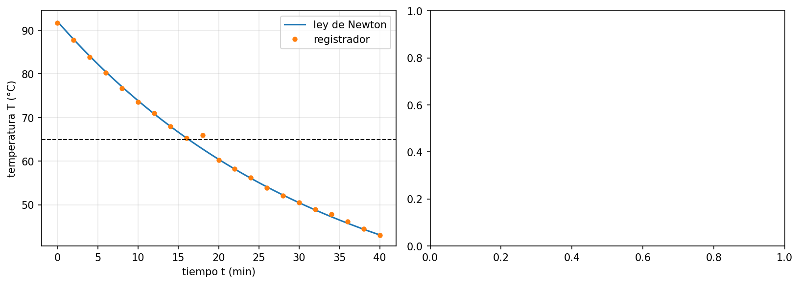

# Simulación del Enfriamiento de Café

## Descripción
Proyecto desarrollado en Python para simular el cambio de temperatura de una taza de café a lo largo del tiempo utilizando la Ley de Enfriamiento de Newton.

## Objetivo
Analizar cómo disminuye la temperatura del café y determinar aproximadamente cuándo alcanza una temperatura deseada.

## Herramientas utilizadas
- Python
- Cálculos matemáticos
- Representación gráfica de resultados

## Datos de la simulación
- Temperatura inicial del café: 92 °C
- Temperatura ambiente: 22 °C
- Constante de enfriamiento: 0.030 min⁻¹
- Tiempo de simulación: de 0 a 40 minutos
- Intervalos de evaluación: 2 minutos
- Temperatura objetivo: 65 °C

## Modelo matemático
T(t) = 22 + 70e^(-0.030t)

## Aplicación
Este proyecto demuestra el uso de programación y modelos matemáticos para analizar fenómenos físicos y obtener resultados útiles mediante simulaciones computacionales.

## Autor
Jorge Ángel Alfonso
Ingeniería en Sistemas Computacionales
Universidad Tecnológica de Panamá

Proyecto académico incluido en un portafolio profesional.
## Resultados de la simulación

El modelo permite analizar cómo disminuye la temperatura del café a medida que transcurre el tiempo. Según el modelo, el café alcanza una temperatura de 65 °C o menos al minuto entero 17.

### Gráfica del proyecto

## Cómo ejecutar el proyecto

1. Tener Python instalado.
2. Instalar las bibliotecas necesarias con `pip install numpy matplotlib`.
3. Descargar el archivo `lab01_esqueleto_corregido.py`.
4. Ejecutar el programa en un entorno de Python.

## Competencias demostradas

- Programación en Python.
- Aplicación de modelos matemáticos.
- Análisis y visualización de datos.
- Resolución de problemas mediante herramientas informáticas.
